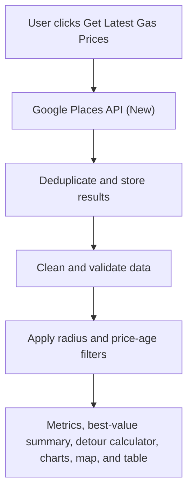

# GSU Gas Station Dashboard
MSA 8030 Project - Interactive dashboard of the best gas options around GSU campus.

Built with **Python, Streamlit, Google Maps Platform, Pandas, and Plotly**.

> **Project Status:** Working MVP (Minimum Viable Product)  
> The core functionality is operational. UI/UX improvements and additional features are currently planned.

---

## 1. Project Overview

The GSU Gas Station Dashboard helps student and staff commuters discover and compare nearby gas stations based on gas prices, distance, and brand.

Users can interactively adjust their search radius, explore gas stations on a map, compare prices across locations, and identify the most affordable options.

The dashboard uses Google Maps Platform to retrieve gas station information and available fuel prices.

### Project Objectives

- Identify affordable gas stations near campus.
- Allow users to customize their search radius.
- Compare gas prices across individual stations and brands.
- Visualize gas station locations geographically.
- Help users evaluate the tradeoff between gas prices and distance.
- Provide a simple, interactive interface for exploring gas station data.

### Campus Location

**Georgia State University – Buckhead Campus**

Reference coordinates:

- Latitude: `33.848057`
- Longitude: `-84.370042`

The current implementation focuses on gas stations within approximately **3 miles of campus**.

---

## 2. Features

### Interactive Gas Station Map

The dashboard displays a Google Map centered on campus.

Features include:

- Campus location marker.
- Gas station markers.
- Interactive station information.
- Adjustable search radius.
- Visual radius circle.
- Smooth radius slider with 0.01-mile precision.
- Dynamic updates as the selected radius changes.

The radius slider operates locally using previously retrieved data, so adjusting it does not require additional Google Places searches.

### Best-Value Station Summary

The dashboard identifies the lowest-priced eligible gas stations within the selected radius.

"Best value" accounts for:

- Regular unleaded gas price.
- Distance from campus.
- Availability of price information.
- Age of reported prices.

When multiple stations share the lowest price, the dashboard selects the closest station among those tied.

### Detour Value Calculator

The dashboard compares the cheapest eligible station with the nearest eligible station. Users can set gallons per fill-up and vehicle efficiency to estimate pump savings, extra fuel cost for the round-trip detour, and net savings. The estimate uses straight-line distances, so it is directional rather than a driving-route quote.

The poster presents the full story, recommendations, and data limitations; the dashboard focuses on interactive exploration.

### Price Comparison Charts

The dashboard includes:

**Price per Gallon by Station**

- Compares individual gas station prices.
- Displays each station separately, including stations sharing the same brand name.
- Allows users to compare prices across nearby locations.

**Gas Price vs. Distance**

- Shows the relationship between gas price and distance from campus.
- Helps users identify relatively inexpensive stations that are also nearby.

**Average Gas Price by Brand**

- Compares average regular unleaded gas prices across brands.
- Uses eligible stations within the selected radius and price-age limit.
- Allows users to evaluate differences between brands.

### Search Preferences

Users can customize:

| Setting | Description |
|---|---|
| Search Radius | Maximum straight-line distance from campus |
| Maximum Time Since Update | Maximum hours since a reported gas price was updated |
| Gallons per Fill-up | Fuel volume used by the detour estimate |
| Car Efficiency | Vehicle miles per gallon used to estimate detour fuel cost |
| Data Refresh | Manually request updated data from Google Places |
| Design Preview | Display the dashboard layout without loading Places data |

### Dashboard Metrics

The dashboard displays:

- Number of stations within the selected radius.
- Number of stations with eligible gas prices.
- Lowest available regular gas price.

### Data Quality Information

The dashboard also summarizes:

- Total gas station listings.
- Listings with available gas prices.
- Listings missing gas prices.
- Listings missing price timestamps.
- Listings sharing the same address.
- Number of unique brands.

### Filtered Station Export

Download the stations currently shown in the table as a CSV. The export follows the selected radius and price-update window.

---

## 3. How the Dashboard Works

The application separates data retrieval, processing, and presentation into individual Python modules.

### Data Flow



### Step 1: Retrieve Gas Station Data

When the user selects **Get Latest Gas Prices**, the application sends requests to the Google Places API (New).

The current search strategy uses nine overlapping geographic search areas to improve coverage around campus.

Each search:

- Uses the Nearby Search (New) endpoint.
- Searches for gas stations within a defined geographic circle.
- Requests available station information and fuel prices.
- Returns up to 20 listings.

The results are combined and deduplicated using Google's unique Place IDs.

This approach is intended to reduce the number of stations missed because of the 20-result limit.

### Step 2: Clean and Validate Data

After retrieval, the application processes the data using `processing/cleaning.py`.

Cleaning operations include:

- Validating geographic coordinates.
- Converting prices and distances into numeric values.
- Removing invalid price values.
- Handling missing information.
- Deduplicating records by Place ID.
- Parsing price update timestamps.
- Calculating the age of reported prices.

Stations with different Place IDs are preserved even if they share an address.

### Step 3: Filter Gas Stations

The application uses `processing/filtering.py` to select eligible stations.

Filters include:

1. Distance from campus must be within the selected radius.
2. Regular unleaded gas price must be available and positive.
3. Price age must be within the selected maximum age.

Stations meeting these conditions are used for price comparisons, the best-value summary, and the detour calculator.

### Step 4: Identify the Best Options

The application:

1. Finds the lowest regular gas price among eligible stations.
2. Identifies all stations offering that price.
3. Selects the closest station if multiple locations are tied.

This currently defines the "best" option as the **lowest-priced eligible station, with distance used as a tiebreaker**.

The station summary uses price and straight-line distance; the detour calculator separately estimates fuel cost using the entered fuel efficiency. The station ranking does not optimize net savings across all stations, and actual driving distances and times are not included.

For the nearest and cheapest eligible stations, the detour calculator computes:

- Pump savings = (nearest station price − cheapest station price) × gallons per fill-up (minimum $0).
- Extra round-trip miles = 2 × (cheapest station distance − nearest station distance) (minimum 0 miles).
- Extra fuel cost = extra round-trip miles ÷ vehicle efficiency (mpg) × cheapest station price.
- Net savings = pump savings − extra fuel cost.

### Step 5: Display Results

The filtered data is sent to the dashboard components:

- Overview metrics.
- Best-value station summary.
- Detour value calculator.
- Price comparison charts.
- Interactive Google Map.
- Available stations table with CSV export.

When the radius or price-age setting changes, these components update using data already retrieved.

**Changing filters does not trigger additional Google Places searches.**

---

## 4. Project Structure

```text
GSU-Gas-Dashboard/
│
├── app.py
│
├── assets/
│   ├── map.html
│   ├── map.css
│   └── map.js
│
├── ui/
│   ├── map.py
│   └── charts.py
│
├── services/
│   └── google_places.py
│
├── processing/
│   ├── cleaning.py
│   └── filtering.py
│
├── .streamlit/
│   └── secrets.toml         # Local only; never commit
│   
├── requirements.txt
├── .gitignore
└── README.md
```

### File Descriptions

| File | Purpose |
|---|---|
| `app.py` | Main Streamlit application; coordinates dashboard components |
| `services/google_places.py` | Handles Google Places API requests and parses station data |
| `processing/cleaning.py` | Cleans, validates, and summarizes station data |
| `processing/filtering.py` | Applies search filters and selects the best-value option |
| `ui/map.py` | Connects the custom map component to Streamlit |
| `ui/charts.py` | Creates and displays Plotly charts |
| `assets/map.html` | HTML structure for the interactive map |
| `assets/map.css` | Map and slider styling |
| `assets/map.js` | JavaScript map interactions and radius slider behavior |
| `.streamlit/secrets.toml` | Stores API credentials locally |
| `requirements.txt` | Lists pinned Python package dependencies |
| `.gitignore` | Prevents sensitive and unnecessary files from being committed |

The separation of modules allows developers to modify individual components without needing to edit the entire application.

---

## 5. Requirements

Before running the project, install:

- Python 3.11 or newer.
- Git.
- A code editor such as Visual Studio Code.
- A Google Cloud project with billing enabled.
- Access to Google Places API (New).
- Access to Google Maps JavaScript API.

### Python Packages

The application uses:

| Package | Purpose |
|---|---|
| `streamlit` | Interactive dashboard framework |
| `pandas` | Data manipulation and processing |
| `plotly` | Interactive charts |
| `requests` | HTTP requests to Google Places |

The custom map also uses HTML, CSS, and JavaScript.

It relies on Streamlit's custom components functionality.

---

## 6. Installation and Local Setup

### Step 1: Clone the Repository

Open a terminal and run:

```bash
git clone https://github.com/acesvd/GSU-Gas-Dashboard.git
```

Navigate into the project:

```bash
cd GSU-Gas-Dashboard
```

### Step 2: Create a Python Virtual Environment

A virtual environment keeps the project's dependencies separate from other Python installations.

#### macOS

```bash
python3 -m venv .venv
```

Activate the environment:

```bash
source .venv/bin/activate
```

#### Windows (PowerShell)

```powershell
py -m venv .venv
```

Activate the environment:

```powershell
.\.venv\Scripts\Activate.ps1
```

When the environment is activated, the terminal should display a prefix similar to:

```text
(.venv)
```

### Step 3: Install Dependencies

Install the dependencies listed in `requirements.txt`:

```bash
python -m pip install -r requirements.txt
```

Alternatively, if the file is unavailable, install the required packages manually:

```bash
python -m pip install streamlit pandas plotly requests
```

### Step 4: Configure Google API Keys

The application requires two Google Maps Platform API keys.

Follow the instructions in Section 7 before running the dashboard.

### Step 5: Run the Dashboard

From the project's root directory, run:

```bash
python -m streamlit run app.py
```

Streamlit should launch the application in your browser.

The default local address is:

http://localhost:8501

If Streamlit chooses another port, use the address displayed in the terminal.

### Step 6: Stop the Application

In the terminal running Streamlit, press:

```text
Ctrl + C
```

To deactivate the virtual environment:

```bash
deactivate
```

---

## 7. Google Maps Platform API Setup

The application uses two Google APIs:

1. **Places API (New)** — retrieves gas station information and available fuel prices.
2. **Maps JavaScript API** — displays and controls the interactive Google Map.

Two separate API keys are recommended because these APIs use different security restrictions.

### Step 1: Create a Google Cloud Project

Visit:

https://console.cloud.google.com/

Sign in with a Google account.

Then:

1. Open the Google Cloud Console.
2. Create a new project or select an existing project.
3. Give the project a recognizable name.
4. Associate the project with a billing account.

Google Maps Platform requires billing to be enabled.

Google may provide no-cost usage allowances, but usage beyond the applicable limits can generate charges.

### Step 2: Enable the Required APIs

In Google Cloud Console:

1. Navigate to **APIs & Services**.
2. Select **Library**.
3. Search for and enable **Places API (New)**.
4. Search for and enable **Maps JavaScript API**.

Official documentation:

- [Places API (New) setup](https://developers.google.com/maps/documentation/places/web-service/get-api-key)
- [Maps JavaScript API setup](https://developers.google.com/maps/documentation/javascript/get-api-key)

### Step 3: Create the Places API Key

Navigate to:

**APIs & Services → Credentials → Create Credentials → API Key**

Create a key for server-side Places API requests.

Recommended configuration:

- **API restrictions:** Restrict to Places API (New).
- **Application restrictions:** Use an appropriate server-side restriction when supported by the deployment environment.

For local development, a stable server IP address may not be available. In that case, keep the key private, restrict it to the required API, and apply suitable usage quotas.

This key should never be included in frontend JavaScript or committed to GitHub.

### Step 4: Create the Maps JavaScript API Key

Create a second API key for the interactive map.

Recommended configuration:

- **Application restrictions:** Websites (HTTP referrers).
- **API restrictions:** Maps JavaScript API.

For local development, configure the appropriate localhost origins or referrers.

Examples:

```text
http://localhost:8501/*
http://127.0.0.1:8501/*
```

If the application is deployed to a public website, add that website's permitted domain or referrer as well.

Unlike the Places API key, the Maps JavaScript API key is used by browser-side JavaScript. It must therefore be appropriately restricted.

See Google's [API key security guidance](https://developers.google.com/maps/api-security-best-practices).

### Step 5: Create the Secrets File

In the root project directory, create a folder named:

```text
.streamlit
```

Inside it, create:

```text
secrets.toml
```

The path should be:

```text
GSU-Gas-Dashboard/.streamlit/secrets.toml
```

Add the following:

```toml
GOOGLE_PLACES_API_KEY = "YOUR_PLACES_API_KEY"

GOOGLE_MAPS_BROWSER_KEY = "YOUR_MAPS_JAVASCRIPT_API_KEY"
```

Replace the placeholders with your own API keys.

Do not include the actual keys in files committed to GitHub.

Streamlit automatically makes these values available through `st.secrets`.

For example:

```python
api_key = st.secrets["GOOGLE_PLACES_API_KEY"]
```

Official documentation:

[Streamlit Secrets Management](https://docs.streamlit.io/develop/concepts/connections/secrets-management)

### Step 6: Restart Streamlit

After creating or modifying `secrets.toml`, restart the application:

```bash
python -m streamlit run app.py
```

The dashboard should now be able to display the map and retrieve gas station data.

---

## 8. Using the Dashboard

### Initial Dashboard

When the application first opens:

- The dashboard layout is displayed.
- Metric cards show placeholder values.
- Charts are empty.
- The map and radius slider are available.
- No Google Places search is automatically performed.

This allows developers to work on the dashboard layout without repeatedly requesting gas station data.

### Retrieve Gas Station Data

In the sidebar, click:

**Get Latest Gas Prices**

The application retrieves station information from Google Places.

Once the requests finish, the dashboard displays available data.

### Adjust the Search Radius

Use the slider above the map to select a radius.

The map circle and displayed stations respond to changes in the selected radius.

The dashboard metrics, best-value summary, detour calculator, charts, map, and station table also update.

Radius changes do not require additional Places API searches.

**Note:** The maximum searchable coverage is determined by the data originally retrieved. Increasing the slider beyond previously retrieved coverage would require a different search implementation.

### Adjust Maximum Time Since Update

Use the sidebar's **Maximum time since update (hours)** control to limit how long ago a gas price was reported.

For example:

- 12 hours: More restrictive; prioritizes recently updated prices.
- 48 hours: Default setting.
- 72 hours: More permissive; may include older reports.

Stations missing usable price timestamps are excluded from eligible-price comparisons.

### Evaluate Detour Savings

In the **Is the detour worth it?** section, adjust **Gallons per fill-up** (default: 12 gallons) and **Car efficiency (mpg)** (default: 25 mpg). Review the estimated pump savings, extra fuel cost, and net savings. These estimates compare the cheapest eligible station with the nearest eligible station and do not use actual driving routes.

### Export Filtered Stations

Select **Download filtered stations (CSV)** below the available stations table to save the currently filtered data.

### Design Preview Mode

Enable:

**Design preview (no live data)**

This mode displays placeholder cards and charts without performing Google Places searches.

It is useful for:

- Testing dashboard layouts.
- Changing colors and styling.
- Adjusting component positioning.
- Developing new UI elements.
- Avoiding unnecessary Places API usage.

The Google Map may still load through the Maps JavaScript API, which has separate usage and billing considerations.

---

## 9. API Usage and Cost Considerations

Google Maps Platform uses usage-based billing.

The project's two main billable services are:

- Places API (New).
- Maps JavaScript API.

### Places API Requests

The current implementation uses nine overlapping Nearby Search requests when the user clicks **Get Latest Gas Prices**.

Therefore:

**One dashboard refresh can generate approximately nine Places API requests.**

The selected radius does not change the number of search requests in the current implementation.

Changing the radius after retrieval does not generate new Places requests.

### Fuel Price Data

The application requests the `fuelOptions` field to obtain available fuel price information.

Google classifies this field under the **Nearby Search Enterprise + Atmosphere** SKU.

Because billing depends on the requested fields and Google may update pricing, consult the current pricing documentation before running large numbers of requests.

### Maps JavaScript API

Displaying an interactive Google Map can generate separately billable map loads.

These are different from Places API searches.

### Monitoring Usage

Monitor usage through:

**Google Cloud Console → Google Maps Platform → Metrics**

Also review:

- Quotas.
- Billing reports.
- Budgets and alerts.
- API-specific request counts.

We recommend configuring billing alerts and suitable quotas before sharing the dashboard with a larger group.

### Official Pricing Documentation

- [Google Maps Platform Pricing](https://developers.google.com/maps/billing-and-pricing/pricing)
- [Places API Usage and Billing](https://developers.google.com/maps/documentation/places/web-service/usage-and-billing)
- [Maps JavaScript API Usage and Billing](https://developers.google.com/maps/documentation/javascript/usage-and-billing)

---

## 10. Data Fields

The application currently processes the following station-level fields:

| Field | Description |
|---|---|
| `Station` | Name of the gas station |
| `Brand` | Identified gas station brand |
| `Latitude` | Geographic latitude |
| `Longitude` | Geographic longitude |
| `Distance (miles)` | Straight-line distance from campus |
| `Regular Price` | Available regular unleaded gas price per gallon |
| `Price Age (hours)` | Time elapsed since the reported price update |
| `Last Updated` | Timestamp associated with the gas price |
| `Place ID` | Google's unique identifier for the listing |
| `Address` | Formatted station address |

These fields are processed using Pandas and passed to the dashboard components.

---

## 11. Data Limitations

### Gas Price Availability

Not every Google Places listing includes fuel price information.

Stations without usable regular gas prices may be included in station discovery results but are excluded from eligible-price comparisons and the best-value summary and detour calculator.

### Geographic Coverage

Nearby Search (New) returns at most 20 results per request.

The application uses overlapping search areas to improve coverage, but complete discovery of every gas station within the region is not guaranteed.

The dashboard reports when one or more searches reach Google's 20-result limit. Listings without usable, recent fuel prices are excluded from eligible-price comparisons.

### Straight-Line Distance

Distances are calculated geographically using latitude and longitude.

They do not represent:

- Actual driving distance.
- Driving time.
- Road accessibility.
- Traffic conditions.

A station that is geographically closer may not necessarily be faster or cheaper to reach by car.

### Price Freshness

Google Places does not guarantee that reported fuel prices match current prices at the pump.

Price timestamps are used to identify how recently prices were updated.

Users should verify gas prices before traveling.

### Best-Value Selection Method

The best-value summary identifies the lowest available eligible price and uses proximity to break ties. The separate detour calculator estimates net savings for that station relative to the nearest eligible station; it does not search all stations for the highest net savings.

The best-value summary does not currently optimize for:

- Fuel consumption during travel.
- Round-trip driving costs.
- Traffic.
- Gas station loyalty programs.
- Membership discounts.
- Differences in fuel quality or service.

The detour calculator uses straight-line distances from campus and the cheapest station's listed fuel price to approximate incremental travel costs. It does not account for road routes, traffic, travel time, or other vehicle operating costs.

### Data Persistence

Retrieved station data is stored in Streamlit session state.

It is not currently saved to a permanent database.

Restarting or losing the application session may require retrieving the data again.

---

## 12. Security

### API Keys

Never commit real API keys to GitHub.

The following file must remain private:

```text
.streamlit/secrets.toml
```

Ensure `.gitignore` contains at least:

```gitignore
# Credentials
.streamlit/secrets.toml
.env
.env.*

# Virtual environments
.venv/
venv/

# Python
__pycache__/
*.py[cod]
.pytest_cache/

# macOS
.DS_Store

# Editors
.vscode/
.idea/
```

The `.gitignore` file prevents new matching files from being added to Git.

However, `.gitignore` does not automatically remove files that were already committed.

If an API key has been accidentally committed or published, remove the exposure and rotate the affected key in Google Cloud Console.

### Recommended Practices

- Use separate keys for Places API and Maps JavaScript API.
- Restrict each key to the required API.
- Apply appropriate application restrictions.
- Monitor usage regularly.
- Never post keys in GitHub issues, discussions, or screenshots.
- Store credentials through Streamlit Secrets Management.

---

## 13. Troubleshooting

### `ModuleNotFoundError`

**Possible cause:** A required Python package is not installed.

**Solution:** Activate the project's virtual environment and install dependencies.

```bash
python -m pip install streamlit pandas plotly requests
```

### `No secrets found` or missing API key

**Possible cause:** The `secrets.toml` file is missing, incorrectly named, or placed in the wrong directory.

**Solution:** Verify that the file exists at:

```text
.streamlit/secrets.toml
```

Check that the variable names match the names expected by the application.

Restart Streamlit after modifying the secrets file.

### `REQUEST_DENIED` or API authorization errors

**Possible causes:**

- API not enabled.
- Billing not configured.
- Incorrect API key.
- API restrictions do not permit the request.

**Solution:** Review the key and enabled APIs in Google Cloud Console.

### `RefererNotAllowedMapError`

**Possible cause:** The browser key's website restrictions do not permit the application's URL or browser referrer.

**Solution:**

1. Open Google Cloud Console.
2. Locate the Maps JavaScript API key.
3. Review its website restrictions.
4. Confirm that the local or deployed application URL is permitted.
5. Check the browser's developer console for the exact authorization error.

### Map Does Not Display

Check:

- Whether Maps JavaScript API is enabled.
- Whether billing is active.
- Whether the browser key is valid.
- Whether its website restrictions are correct.
- Whether the browser console reports JavaScript errors.

### No Gas Prices Appear

Possible reasons include:

- Google Places does not provide prices for the returned stations.
- Price timestamps are missing.
- Reported prices are older than the selected maximum age.
- No eligible stations fall within the selected radius.

Try increasing the radius or maximum price age.

### Dashboard Changes Do Not Appear

Save the modified files and rerun Streamlit.

If necessary, stop the server and restart:

```bash
python -m streamlit run app.py
```

---

## 14. Development and Collaboration

This project is designed to support collaborative development.

The codebase separates backend processing from presentation components so team members can work on different areas of the application.

### Suggested Development Areas

| Area | Relevant Files |
|---|---|
| API Integration | `services/google_places.py` |
| Data Quality and Processing | `processing/cleaning.py` |
| Filtering and Best-Value Selection | `processing/filtering.py` |
| Interactive Map | `ui/map.py`, `assets/` |
| Charts and Visualizations | `ui/charts.py` |
| Overall Dashboard | `app.py` |

### Recommended Git Workflow

1. Pull the latest changes from the main branch.
2. Create a separate branch for new features.
3. Implement and test the changes locally.
4. Verify that no credentials are included.
5. Commit changes with descriptive messages.
6. Open a pull request for team review.
7. Merge tested changes into the main branch.

Avoid committing directly to the main branch when multiple team members are actively developing features.

---

## 15. Planned Improvements

The current version focuses on establishing reliable functionality.

Potential next steps include:

### UI/UX Improvements

- Improved dashboard layout.
- Consistent styling and color palette.
- More detailed best-value station insights.
- Improved map presentation.
- Responsive layouts.
- Additional interactive elements.

### Analytical Improvements

- More accurate driving cost estimates using actual routes.
- Driving distance and travel time.
- Total trip cost comparisons across all eligible stations.
- Improved station ranking methodology.
- Additional brand-level comparisons.
- Price freshness indicators.

### Technical Improvements

- Persistent data storage.
- Improved data caching.
- Additional error handling.
- Automated testing.
- Configurable campus locations.
- Deployment for broader access.

---

## 16. Technology Stack

| Technology | Role |
|---|---|
| Python | Application programming |
| Streamlit | Dashboard framework |
| Google Places API (New) | Gas station and fuel price data |
| Google Maps JavaScript API | Interactive map |
| Pandas | Data processing |
| Plotly | Data visualization |
| HTML/CSS/JavaScript | Custom map interactions |
| Git/GitHub | Version control and team collaboration |

---

## 17. References

### Google Maps Platform

- [Google Maps Platform Documentation](https://developers.google.com/maps/documentation)
- [Nearby Search (New)](https://developers.google.com/maps/documentation/places/web-service/nearby-search)
- [Google Maps JavaScript API](https://developers.google.com/maps/documentation/javascript)
- [Google Maps Platform Pricing](https://developers.google.com/maps/billing-and-pricing/pricing)

### Streamlit

- [Streamlit Documentation](https://docs.streamlit.io/)
- [Streamlit Secrets Management](https://docs.streamlit.io/develop/concepts/connections/secrets-management)
- [Streamlit Custom Components](https://docs.streamlit.io/develop/concepts/custom-components)

### Other Technologies

- [Pandas Documentation](https://pandas.pydata.org/docs/)
- [Plotly Python Documentation](https://plotly.com/python/)

---

## 18. Disclaimer

This dashboard is intended for educational and analytical purposes.

Gas station information and fuel prices are obtained through Google Maps Platform and are subject to availability and applicable Google Maps Platform terms.

Displayed prices may differ from actual pump prices.

The project is not intended to guarantee the lowest available gas price or shortest driving route.

This is a student-developed project and does not imply official endorsement by Google or Georgia State University.
